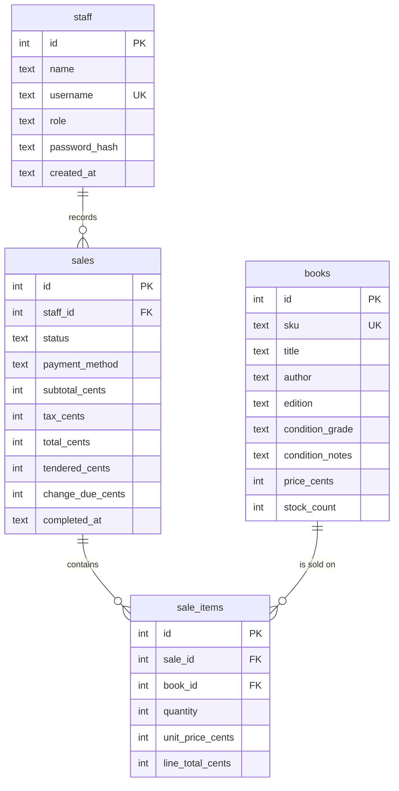

# Book Store Management schema

Prices and totals are integer cents. A book priced at $12.50 is stored as `1250`.

A staff member is a `manager` or a `cashier`. `password_hash` stays empty until sign-in.

A book’s condition grade is `Fine`, `Very Good`, `Good`, `Fair`, or `Poor`. SKU is unique regardless of letter case. Price and stock cannot be negative.

A sale belongs to one staff member. Its total is the subtotal plus tax. A completed sale names `cash` or `card`. A completed cash sale stores the amount tendered and the change due, and the tendered amount covers the total. A card sale does not store a cash tender or change. Staff usernames are unique regardless of letter case.

A sale item belongs to one sale and one book. The same book appears once on a sale. The line total is the unit price times the quantity. A book or a staff member with a sale on record cannot be deleted, and a sale that still has items cannot be deleted.
